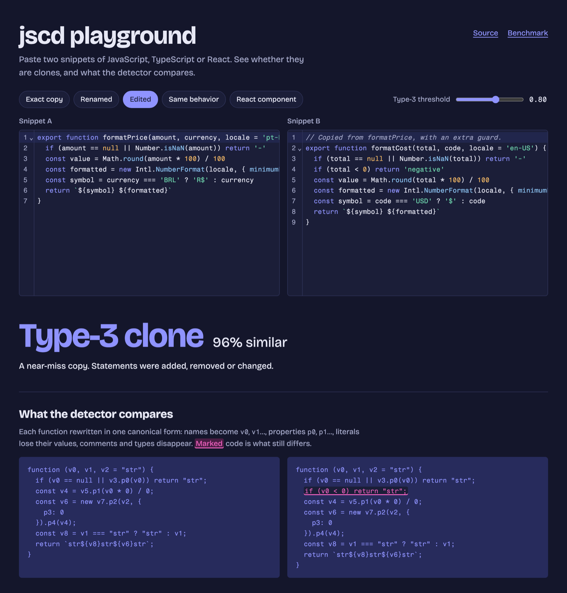
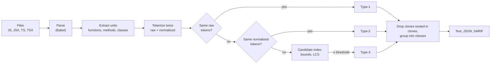

# JavaScript Clone Detection

[](https://github.com/felipelealdefaria/javascript-clone-detection/actions/workflows/ci.yml)
[](https://www.npmjs.com/package/javascript-clone-detection)
[](LICENSE)

Finds copy-pasted code in JavaScript, TypeScript and React projects, including copies that were renamed or edited after pasting. It compares syntax trees, not text, so formatting, comments, names, literal values and arrow-vs-regular function syntax don't hide a copy.

**[Try it in the browser →](https://felipelealdefaria.github.io/javascript-clone-detection/)** Paste two snippets and see what the detector compares.



This started in 2021 as my bachelor's thesis on code duplication in JavaScript applications ([background](#background-the-2021-thesis)). Version 1 is a rewrite, with a benchmark that checks it and an empirical study that uses it.

## At a glance

- **Finds edited copies.** On a [benchmark](#results) of 179 real functions and components, it finds 78% of copies edited after pasting, against 38% for jscpd at its strictest structural settings.
- **Measured on real apps.** Across [12 open-source React apps](#empirical-study) (6.1 million lines), 3.8% of production code is cloned, against 24.9% of test code (medians).
- **Reports hold up.** 86–100% of sampled reports were real clones, depending on the codebase.
- **Fast enough for CI.** It scans grafana's frontend (1.1 million lines) in 12 s, and can report only the clones a pull request introduces.

## Quick start

```bash
npx javascript-clone-detection src
```

```text
#1 Type-2 · 2 copies
  src/components/TeamMemberCard.tsx:9-24  TeamMemberCard · 129 tokens
  src/components/UserCard.jsx:3-18        UserCard · 129 tokens

#2 Type-3 · 2 copies · ≥ 95% similar
  src/utils/format.js:1-7    formatPrice · 66 tokens
  src/utils/format.js:10-17  formatCost · 72 tokens

2 clone classes from 2 clone pairs (0 Type-1, 1 Type-2, 1 Type-3).
Scanned 3 files and 4 units in 11 ms.
```

Install it to get the `jscd` command: `npm i -D javascript-clone-detection`.

| Option | Default | |
|---|---|---|
| `-t, --threshold <0-1>` | `0.8` | Minimum similarity for Type-3 clones |
| `-m, --min-tokens <n>` | `50` | Ignore functions smaller than this |
| `-f, --format <format>` | `text` | `text`, `json` or `sarif` |
| `-o, --output <file>` | stdout | Write the report to a file |
| `-i, --ignore <glob>` | | Exclude files (repeatable). `node_modules`, `dist`, `build`, `coverage`, `*.min.js` and `*.d.ts` are always excluded |
| `-c, --changed <ref>` | | Only report clones touching lines changed since a git ref, e.g. `origin/main` |
| `--fail` | | Exit with code 1 when clones are found |

Test code is cloned far more than production code, and much of it on purpose. To focus on production code: `jscd src --ignore "**/*.test.*" --ignore "**/*.spec.*"`.

### In GitHub Actions

Clones show up as code scanning alerts:

```yaml
permissions:
  contents: read
  security-events: write

steps:
  - uses: actions/checkout@v5
  - uses: felipelealdefaria/javascript-clone-detection@v1
    with:
      paths: src
      ignore: |
        **/*.test.ts
  - uses: github/codeql-action/upload-sarif@v4
    with:
      sarif_file: jscd.sarif
```

On pull requests, report only the duplication the PR introduces or touches:

```yaml
  - uses: actions/checkout@v5
    with:
      fetch-depth: 0
  - uses: felipelealdefaria/javascript-clone-detection@v1
    with:
      changed-since: origin/${{ github.base_ref }}
      fail-on-clones: true
```

### From code

```ts
import { detectClonesInPaths } from 'javascript-clone-detection'

const result = await detectClonesInPaths(['src'], { threshold: 0.85 })
for (const cls of result.classes) console.log(cls.type, cls.members.map((m) => m.name))
```

The `javascript-clone-detection/core` entry point has no Node dependencies. It takes file contents instead of paths, so it runs in the browser (the playground uses it):

```ts
import { detectClones } from 'javascript-clone-detection/core'

detectClones([
  { path: 'a.js', code: '…' },
  { path: 'b.js', code: '…' },
])
```

## Results

On a [mutation-based benchmark](benchmark/README.md): 179 real functions and components from lodash-es, reactstrap and semantic-ui-react, each with a Type-1, Type-2 and Type-3 mutant, plus 16 hand-written Type-4 pairs. Compared with [jscpd 5.4.2](https://github.com/kucherenko/jscpd), including its own renamed-clone and AST similarity modes.

| Tool | Type-1 | Type-2 | Type-3 | Type-4 | Precision |
|---|---:|---:|---:|---:|---:|
| **jscd** (defaults) | 100% | 100% | **78.2%** | 0/16 | 100% |
| jscpd (defaults) | 77.1% | 0.6% | 0% | 0/16 | 96.6% |
| jscpd `--ignore-identifiers --ignore-literals --similarity 0.8` | 98.9% | 76.0% | 38.0% | 0/16 | 92.1% |

- **Type-3 is the informative row.** jscd finds 96% of copies with one edit, 77% with two and 58% with three. Type-1 and Type-2 recall of 100% is expected by design: those mutations are exactly what the normalizer erases.
- **Precision on real code:** on the unmodified libraries, 29 of 29 sampled reports were real clones, so precision is at least 88% at 95% confidence. The [sample, with code](benchmark/results/precision-sample.md), is there to audit.
- **Type-4 needs a different tool.** Code embeddings (jina-embeddings-v2-base-code) found 8 of 9 held-out Type-4 pairs, but only 12.5% of renamed copies, at 58.5% precision. Combining both finds everything jscd finds plus the Type-4 pairs, at 80% precision ([experiment](benchmark/results/embeddings.md)).

Full results: [benchmark/results/results.md](benchmark/results/results.md). Method and threats to validity: [benchmark/README.md](benchmark/README.md).

## Empirical study

The thesis asked how much real JavaScript code is cloned. [The study](study/README.md) answers it again with v1, in two parts.

**Replication of the thesis** on its three projects, at their 2021 commits. The minimum size explains most of the precision gap. Run like v0.6 (no size minimum), v1's sampled precision is 64%, against v0.6's 68.4%; with the 50-token default it is 96% (26 of 27).

**12 open-source React apps** (excalidraw, grafana, sentry, mastodon, Signal and others; 6.1 million lines):

- **3.8%** of production code (median) sits in a cloned function, method or class; tests are cloned about six times as often (24.9%).
- 70% of clone classes are in tests. Of the production ones, only 21.5% are components; most are services, thunks, handlers and utilities.
- **83% of clone classes are Type-3:** copies that were edited after pasting.
- 31 of 36 sampled pairs are real clones (86%).

## Clone types

| Type | What differs between the copies | Detected |
|---|---|---|
| **Type-1** | Whitespace, layout, comments, and arrow vs. regular function syntax | Yes, by hashing |
| **Type-2** | Also identifier names and literal values | Yes, by hashing |
| **Type-3** | Also added, removed or changed statements | Yes, by similarity ≥ threshold |
| **Type-4** | Everything: same behavior, different code | No ([see the experiment](#results)) |

## How it works



1. **Parse** every file with Babel. JSX and TypeScript work in any file; a file that can't be parsed is reported and skipped.
2. **Extract units:** every function, method and class, including nested ones.
3. **Tokenize each unit twice.** The raw stream keeps names and values; equal raw streams are Type-1 clones. The normalized stream renames identifiers by order of first appearance and keeps only each literal's kind; equal normalized streams are Type-2 clones.
4. **Find Type-3 pairs** without comparing every pair: a shingle index proposes candidates, cheap upper bounds discard most of them, and a bit-parallel LCS scores the rest.
5. **Report** clone classes as text, JSON or SARIF.

These two functions have the same normalized form, so they are Type-2 clones:

```js
export const greet = ({ user }) => {
  // say hi
  return 'Hello, ' + user.name
}

function welcome({ user: person }) {
  return "Welcome, " + person.name;
}

// What the detector compares, for both:
function ({ p0: v0 }) {
  return "str" + v0.p1;
}
```

Each step in detail, the design decisions behind them, and performance figures: [docs/how-it-works.md](docs/how-it-works.md).

## Limitations

- Type-4 clones (same behavior, different code) are out of scope for a structural detector.
- The unit is a whole function, method or class. A duplicated block inside two otherwise different functions is found only if the functions are similar overall.
- Similarity is order-sensitive: swapping two independent statements counts as an edit.
- The benchmark's mutants are synthetic, and its Type-4 pairs and precision labels come from the same author as the tool.

## Background: the 2021 thesis

This project began as my bachelor's thesis in Software Engineering at UTFPR: _Estudo empírico sobre duplicação de código em aplicações JavaScript_ (2021), advised by Prof. Dr. Gustavo Jansen de Souza Santos. It is in Portuguese: [UTFPR repository record](http://repositorio.utfpr.edu.br/jspui/handle/1/30141) · [PDF](https://repositorio.utfpr.edu.br/bitstreams/3d7f991b-c0e3-4174-9d7e-5f8b3d5c34ed/download). It cites estimates that 7–23% of a typical system is cloned code. In its [proposal](https://drive.google.com/file/d/1MN8iBSfdD1yGMQ9aV-jwjdwJvRckiLfy/view?usp=sharing), JSInspect, jscpd and Code Climate, run on a small React app, flagged no similar components as clones.

The thesis built v0.6 and ran it on freeCodeCamp, trekhleb/javascript-algorithms and TheAlgorithms/JavaScript. Every candidate was validated by hand: 219 of 320 were real clones (68.4% precision), mostly Type-3. Its conclusion was that manual validation stays necessary, because what counts as a clone depends on the reader.

Version 0.6 proved the core idea: normalizing syntax trees turns arrow-vs-regular and renamed copies into identical text. But it couldn't parse JSX, so it couldn't read React components. It scored with Levenshtein distance on text, compared every pair, and wrote its working files into the scanned directory. Version 1 keeps the idea and rebuilds everything else:

| | v0.6 (2021) | v1 (2026) |
|---|---|---|
| Languages | JavaScript, no JSX | JavaScript, JSX, TypeScript, TSX |
| Units | Top-level functions | Functions, methods, classes, nested |
| Renaming | Every name → one placeholder | Consistent, with separate property names |
| Scoring | Levenshtein on regenerated code, all pairs | Hashing, candidate index and bit-parallel LCS |
| Output | A score; files written into the scanned folder | Type-1/2/3 classes; text, JSON or SARIF |
| Evaluation | 3 projects, every candidate validated by hand | Mutation benchmark vs. jscpd, replication, 12 React apps |

The 2021 examples live on as [test fixtures](test/fixtures/legacy) and as presets in the playground. The original code is at [v0.6.0](https://github.com/felipelealdefaria/javascript-clone-detection/tree/v0.6.0). To cite this work, use GitHub's "Cite this repository" button ([CITATION.cff](CITATION.cff)).

## Development

```bash
npm install
npm test              # vitest
npm run lint          # biome
npm run typecheck
npm run build         # dist/
npm run playground    # local playground at http://localhost:5173
npm run bench         # benchmark (downloads the corpus once)
npm run study         # empirical study (fetches 15 projects once)
```

Requires Node 22.18 or later.

## License

[MIT](LICENSE)
